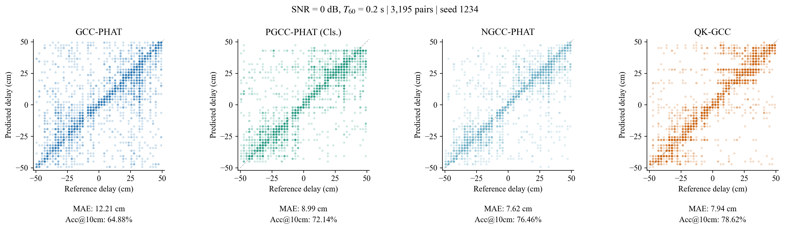
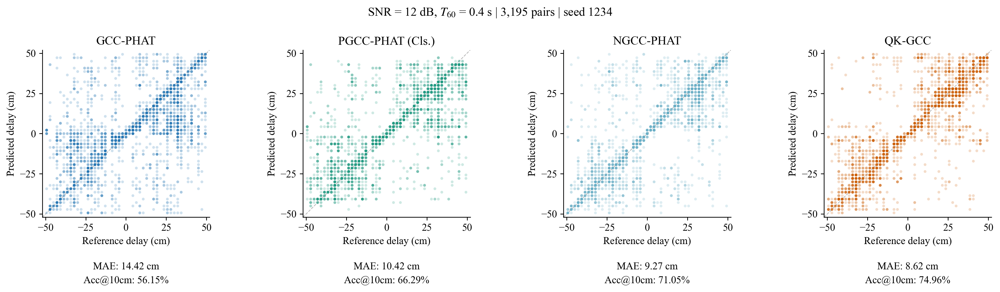
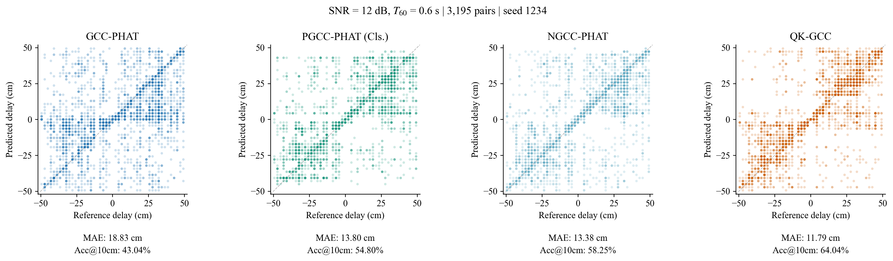

# QK-GCC

Official implementation of **QK-GCC: Learnable Query-Key Spectral Matching for Robust Time Delay Estimation**.

[[arXiv](https://arxiv.org/abs/2609.38000)] [[PDF](https://arxiv.org/pdf/2609.38000)]

QK-GCC replaces the fixed cross-channel spectral product in generalized cross-correlation with local Query-Key matching. The released model is the lightweight single-pass version: it computes only \(Q_1K_2\), learns frequency reliability, and uses random channel swapping during training. No GCC response or GCC-derived prior is used by the model.


## Highlights

- Learnable local spectral matching between two microphone signals.
- Magnitude-phase tokens with separate Query and Key projections.
- Center, symmetric, and antisymmetric offset decomposition.
- 322K parameters and 208M FLOPs under the paper's counting protocol.
- Robust evaluation across noise, reverberation, and unseen source types.

## Results

Results are reported as mean (standard deviation) over three seeds. RMSE and MAE are measured in samples.

| Method | Params | FLOPs | RMSE | MAE | Acc@10cm |
|---|---:|---:|---:|---:|---:|
| GCC | - | 0.7M | 11.89 | 8.00 | 48.57% |
| PGCC | 11.56M | 219M | 10.44 (0.36) | 6.37 (0.27) | 57.85 (1.76)% |
| NGCC | 888K | 3682M | 10.34 (0.08) | 6.06 (0.08) | 61.62 (0.47)% |
| **QK-GCC** | **322K** | **208M** | **8.83 (0.07)** | **5.29 (0.05)** | **66.69 (0.27)%** |

Zero-shot evaluation uses the original speech-trained checkpoints without fine-tuning.

| Source | RMSE | MAE | Acc@10cm |
|---|---:|---:|---:|
| MUSAN Noise | 9.37 (0.04) | 5.59 (0.02) | 65.46 (0.15)% |
| MUSAN Music | 9.59 (0.09) | 6.04 (0.03) | 60.54 (0.08)% |


### Detailed test results

The [complete SNR × T60 comparison](docs/results.md) reports MAE, RMSE, and
Acc@10cm for GCC, PGCC, NGCC, and QK-GCC (seed 1234).

The following three examples illustrate different noise/reverberation conditions.
Each comparison includes all 3,195 pairs, including outliers. Scatter axes and MAE
are in **cm**; errors in the complete table are in **samples**.







## Installation

Python 3.10 or newer is recommended. A CUDA-enabled PyTorch installation is optional but recommended for training.

```bash
git clone https://github.com/zhangjinkai33-ui/QK-GCC.git
cd QK-GCC
python -m venv .venv
source .venv/bin/activate
pip install --upgrade pip
pip install -e .
```

On Windows, activate the environment with `.venv\Scripts\activate`.

## Data preparation

Data are not distributed with this repository. The scripts below generate the simulated two-channel pairs used by the training and evaluation code.

Generate the speaker-disjoint LibriSpeech training, validation, and test sets:

```bash
python scripts/prepare_librispeech.py \
  --librispeech-root data/LibriSpeech \
  --output-root data/qkgcc_raw \
  --download
```

Pack training and validation pairs for faster loading:

```bash
python scripts/pack_dataset.py \
  --input-root data/qkgcc_raw \
  --output-root data/qkgcc_packed
```

Generate the MUSAN zero-shot sets:

```bash
python scripts/prepare_musan.py \
  --musan-root data/musan \
  --source-type noise \
  --output-root data/musan_noise

python scripts/prepare_musan.py \
  --musan-root data/musan \
  --source-type music \
  --output-root data/musan_music
```

The simulation follows the paper: 16 kHz audio, 2048-sample frames, \(T_{60}\sim U(0.2,1.0)\) s, SNR \(\sim U(0,30)\) dB, a 0.5 m microphone spacing, and a 47-class delay grid from -23 to 23 samples.

## Training

```bash
python train.py \
  --data-root data/qkgcc_packed \
  --output-dir runs/qkgcc_seed1234 \
  --seed 1234 \
  --epochs 30 \
  --batch-size 32 \
  --swap-probability 0.5
```

Training uses cross-entropy, Adam, cosine learning-rate decay, and per-sample random channel swapping with delay-sign reversal.

## Evaluation

```bash
python evaluate.py \
  --data-root data/qkgcc_raw \
  --checkpoint checkpoints/qkgcc_seed1234.pt \
  --output results/librispeech.csv
```

The same command evaluates a generated MUSAN directory:

```bash
python evaluate.py \
  --data-root data/musan_noise \
  --checkpoint checkpoints/qkgcc_seed1234.pt \
  --output results/musan_noise.csv
```

The included checkpoint is the representative seed-1234 model. Its full LibriSpeech test-grid result is 8.8363 RMSE, 5.2943 MAE, and 66.66% Acc@10cm.

## Model use

```python
import torch
from qkgcc import QKGCC

checkpoint = torch.load("checkpoints/qkgcc_seed1234.pt", map_location="cpu")
model = QKGCC(**checkpoint["model_config"])
model.load_state_dict(checkpoint["model"])
model.eval()

x1 = torch.randn(1, 2048)
x2 = torch.randn(1, 2048)
delay_samples = model.predict(x1, x2)
```

## Interpretability

The Query-Key norm product acts as a learned frequency-reliability score, while local offset matching captures neighboring spectral evidence. The decomposed delay head retains center, symmetric, and antisymmetric components.


## Repository layout

```text
qkgcc/                   model, datasets, metrics, and room simulation
scripts/                 LibriSpeech/MUSAN preparation and dataset packing
train.py                 training entry point
evaluate.py              30-condition evaluation entry point
checkpoints/             representative released checkpoint
assets/                  paper figures
benchmarks/              condition metrics and aligned prediction results
docs/                    detailed results and visualization protocol
tests/                   lightweight model checks
```

## Citation

If you find QK-GCC useful, please cite:

```bibtex
@article{zhang2026qkgcc,
  title   = {QK-GCC: Learnable Query-Key Spectral Matching for Robust Time Delay Estimation},
  author  = {Zhang, Jinkai and Chen, Weiye and Huang, Yue and Tu, Xiaotong and Ding, Xinghao},
  journal = {arXiv preprint arXiv:2609.38000},
  year    = {2026},
  doi     = {10.48550/arXiv.2609.38000}
}
```

## License

This project is released under the MIT License.

Maintainer: `jinkz33@XMU&UofG`
